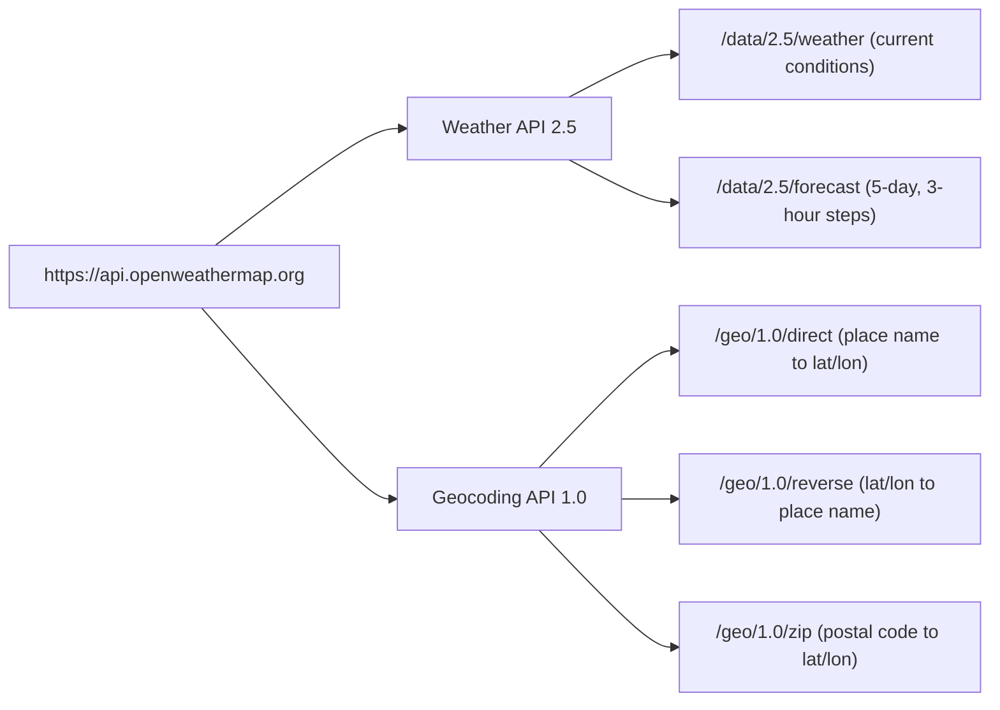
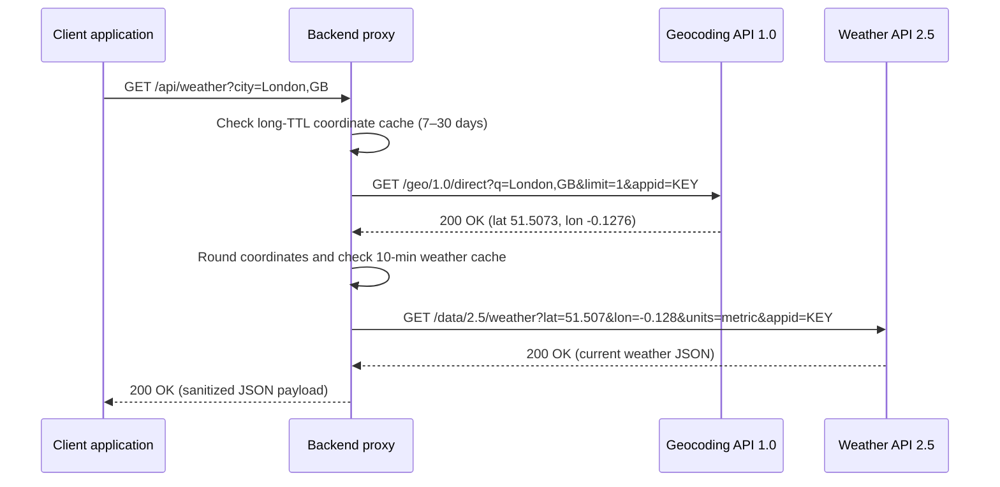
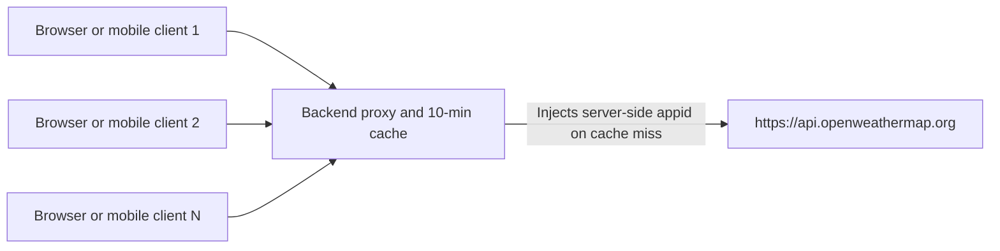

# API architecture overview

Production integrations with OpenWeatherMap rely on three architectural patterns: decoupled versioning between geographic lookup and atmospheric telemetry, coordinate-based request pipelines with tiered cache lifetimes, and server-side proxy mediation between client interfaces and `https://api.openweathermap.org`.

## Independent service versioning

Although every free-tier endpoint is served from a single HTTPS gateway (`https://api.openweathermap.org`), OpenWeatherMap mounts domain capabilities under independently versioned path namespaces rather than a single monolithic version number:

Decoupling **Geocoding API `1.0`** from **Weather API `2.5`** reflects a fundamental mismatch between geographic data and meteorological telemetry:

- **Divergent rates of change**: Administrative boundaries, postal codes, and multilingual place names (`local_names`) evolve on geopolitical timescales measured in months or years. Surface temperature, wind gusts, and radar precipitation shift every 10 minutes.
- **Disambiguation before observation**: Legacy string queries (`GET /data/2.5/weather?q=Portland`) force the weather engine to guess which `"Portland"` or `"Springfield"` a user meant without exposing alternative candidates. Extracting geocoding into `/geo/1.0/direct` returns up to 5 ranked candidates complete with `name`, `state`, `country`, `lat`, and `lon`, letting applications confirm the exact municipality before querying weather models.
- **Independent schema and plan boundaries**: Separating path prefixes also isolates free-tier `2.5` and `1.0` services from paid aggregation products such as One Call API `3.0` (`/data/3.0/onecall`), which operates on a separate per-call billing contract.

## Two-step coordinate resolution pipeline

Modern OpenWeatherMap integrations treat `lat` and `lon` as the primary key for every weather request. When a user searches by city name or postal code, the application resolves human text into geographic coordinates first and queries Weather API `2.5` second—applying distinct cache lifetimes to each stage.

Separating coordinate lookup from weather retrieval unlocks substantially higher cache hit ratios across your infrastructure:

| Service endpoint | Upstream update cadence | Recommended proxy TTL | Architectural rationale |
| --- | --- | --- | --- |
| `/geo/1.0/direct`, `/geo/1.0/reverse`, `/geo/1.0/zip` | Static gazetteer updates | 7–30 days (or persisted per saved user location) | City coordinates do not move; once a user saves a city, persist its `lat` and `lon` so subsequent refreshes skip geocoding entirely. |
| `/data/2.5/weather` | Every 10 minutes | 10 minutes (`600 s`) | Matches OpenWeatherMap's observation assimilation cycle; rounding `lat` and `lon` to 3 decimal places (`~110 m`) coalesces nearby lookups onto one grid cell. |
| `/data/2.5/forecast` | Every 3 hours (synoptic runs) | 30–60 minutes | NWP forecast batches update on 3-hour schedules, allowing longer cache retention than current station snapshots. |

## Direct client calls versus backend-for-frontend (BFF) proxy topology

During initial prototyping or inside developer tools (such as the [interactive API playground](/playground), where you supply your own personal key in browser storage), calling `https://api.openweathermap.org` directly from client code validates connectivity with minimal setup. For multi-user production software, however, routing traffic through a **backend-for-frontend (BFF) proxy**—such as an Express route, FastAPI service, Next.js Route Handler, or serverless edge worker—is essential.

Comparing the two topologies highlights three production failure modes that a BFF proxy eliminates:

| Production concern | Direct browser or mobile calls | Backend-for-frontend (BFF) proxy |
| --- | --- | --- |
| **API key secrecy** | Bundling `appid` into frontend code (`VITE_`, `NEXT_PUBLIC_`, or `REACT_APP_` variables) exposes the raw credential in browser DevTools network logs and compiled JavaScript bundles, enabling quota theft. | `OPENWEATHER_API_KEY` stays strictly in server-side environment variables or secret managers and never crosses the public network to clients. |
| **Browser CORS preflights** | Attaching custom HTTP headers (such as `Authorization` from global Axios or Fetch interceptors) triggers a browser `OPTIONS` preflight request that OpenWeatherMap rejects with a CORS failure. | Server-to-server HTTPS calls are not governed by browser same-origin policy, eliminating preflight rejections and mixed-content blocks. |
| **Multi-user quota scaling** | Request volume scales linearly with visitor traffic: 200 concurrent readers viewing a homepage weather widget fire 200 requests/minute, breaching the 60 calls/minute free-tier limit and triggering `429` blocks. | Request volume scales with unique cached locations rather than visitor count: 10,000 readers viewing London within 10 minutes trigger **1** upstream API call. |

## Related resources

- [How weather data works](./how-weather-data-works) for data assimilation, spatial grids, and 3-hour synoptic windows
- [Unit systems and conversions](./units) for why canonical `metric` caching avoids splitting proxy cache keys
- [Query weather by coordinates](../how-to/use-coordinates) for implementing the two-step geocoding and weather workflow
- [Set up rate limiting and caching](../how-to/rate-limiting) for production Node.js and Python caching proxy implementations
