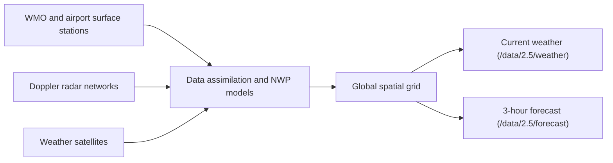

# How weather data works

When your application queries the OpenWeatherMap API for a pair of coordinates, it doesn't read a standalone thermometer bolted to that exact street corner. Instead, the API serves values from a continuously updated global atmospheric grid synthesized from heterogeneous observational networks and physics-based prediction models.

Understanding how OpenWeatherMap ingests, interpolates, and schedules those updates explains why several response fields—such as `dt`, `main.temp_min`, `pop`, and `rain.3h`—behave the way they do in production payloads.

## Multi-source meteorological assimilation

No single observing network covers every square kilometer of Earth's surface, oceans, and upper atmosphere. OpenWeatherMap combines four complementary data streams inside its data assimilation pipeline:

1. **WMO and airport surface stations**: Standardized SYNOP and METAR ground reports from World Meteorological Organization (WMO) member agencies (such as NOAA in the United States and the Met Office in the United Kingdom), airport weather stations, and tens of thousands of automated weather stations measuring 2 m air temperature, barometric pressure, dew point, and 10 m wind vectors.
2. **Doppler weather radar networks**: Ground-based radar sweeps that measure hydrometeor reflectivity to track active rain bands, snowfall intensity, and convective storm cells at high spatial resolution.
3. **Geostationary and polar-orbiting satellites**: Multispectral visible and infrared radiometry that observes cloud-top temperatures, cloud fraction (`clouds.all`), and atmospheric moisture over regions sparse in ground sensors, including oceans and mountain ranges.
4. **Numerical Weather Prediction (NWP) models**: Global and regional physics simulations (incorporating feeds such as NOAA GFS and ECMWF) fused with statistical post-processing and machine learning assimilation models to reconcile sensor disagreements, reject faulty station spikes, and interpolate values between stations.

## Spatial grid interpolation and why `temp_min` often equals `temp_max`

Because physical weather stations sit kilometers apart, OpenWeatherMap projects assimilated observations onto a continuous geographic grid. When a request supplies `lat` and `lon`, the model evaluates the containing grid cell alongside nearby reporting stations, weighted by distance, elevation, and observation freshness.

This spatial design produces two behaviors that frequently surprise developers inspecting `/data/2.5/weather`:

- **Nearby coordinates share readings**: Two coordinates a few hundred meters apart inside the same neighborhood resolve against the same underlying station cluster and grid cell, returning identical temperature, pressure, and wind readings.
- **`main.temp_min` and `main.temp_max` measure spatial spread, not 24-hour highs and lows**: In `/data/2.5/weather`, `temp_min` and `temp_max` do **not** represent today's forecast daily minimum and maximum temperatures. Instead, they represent the **instantaneous minimum and maximum temperatures currently observed** across multiple stations or sub-grid points within a large metropolitan region (for example, cooler coastal neighborhoods versus warmer inland basins across Greater London or Los Angeles).

:::info Computing daily high and low temperatures
In smaller cities, rural areas, or ocean coordinates governed by a single interpolated grid cell, `main.temp`, `main.temp_min`, and `main.temp_max` in `/data/2.5/weather` hold the exact same number. To display upcoming daily highs and lows on the free tier, aggregate the minimum and maximum values across the 3-hour intervals in the [5-day forecast endpoint](../reference/forecast).
:::

## Observation latency and why `dt` trails wall-clock time

Every `/data/2.5/weather` payload includes a top-level `dt` integer representing a Unix UTC timestamp in seconds. That timestamp records **when the meteorological observation or model assimilation snapshot was calculated**—not when OpenWeatherMap's HTTP gateway serialized your JSON response.

Between physical sensor sampling, telemetry transmission, automated quality control, and global grid recalculation, OpenWeatherMap refreshes current weather snapshots on a **10-minute cycle**. As a result:

- **`dt` routinely trails current UTC wall-clock time by up to 10 minutes**: Receiving a payload at `14:28 UTC` whose `dt` decodes to `14:20 UTC` indicates normal pipeline operation rather than stale or broken data.
- **Sub-minute polling yields duplicate readings**: Querying `/data/2.5/weather` every few seconds for the same coordinates returns the exact same observation snapshot while consuming your 60 calls per minute quota. Aligning your backend cache time-to-live (TTL) to **10 minutes** (`600 s`) matches upstream model freshness without sacrificing accuracy.

## Synoptic 3-hour forecast windows, `pop`, and `rain.3h`

Unlike current observations, medium-range weather prediction solves coupled differential equations across the global atmosphere on scheduled batch cycles. The `/data/2.5/forecast` endpoint exposes 5 days of predictions divided into **40 intervals of 3 hours each**, aligned to the **8 standard WMO synoptic UTC hours**:

| Synoptic window (UTC) | Coverage period (UTC) | Steps per 24-hour UTC day |
| --- | --- | --- |
| `00:00`, `03:00`, `06:00`, `09:00` | Midnight through noon UTC in 3-hour increments | Steps 1–4 |
| `12:00`, `15:00`, `18:00`, `21:00` | Noon through midnight UTC in 3-hour increments | Steps 5–8 |

Regardless of whether you query Tokyo (`UTC+9`), London (`UTC+0` or `UTC+1`), or New York (`UTC-5` or `UTC-4`), forecast step timestamps (`list[].dt`) always snap to those fixed UTC boundaries. Applications convert step labels into local civil time by adding `city.timezone` (the location's UTC offset in seconds) to each item's `dt`.

Within each 3-hour forecast step, precipitation behavior is split across two complementary metrics:

- **Probability of precipitation (`pop`)**: A floating-point ratio from `0` to `1` (`0%` to `100%`) expressing the likelihood that measurable precipitation (`0.1 mm` or more of liquid equivalent) falls at the requested coordinate at any point during that 3-hour window.
- **Accumulated volume (`rain.3h` and `snow.3h`)**: Expected precipitation depth in millimeters (`mm`) summed across the 3-hour interval. When the model predicts zero measurable rain or snow for a window, OpenWeatherMap omits the `rain` or `snow` object from that array element rather than emitting `0`.

Distinguishing probability from volume prevents misleading UI summaries. Widespread stratiform drizzle can produce high certainty with low volume (`"pop": 0.92` alongside `"rain": { "3h": 0.5 }`), whereas scattered afternoon thunderstorms can carry moderate point probability with heavy localized accumulation (`"pop": 0.4` alongside `"rain": { "3h": 14.2 }`).

## Related resources

- [Current weather reference](../reference/current-weather) for field-by-field schemas of `/data/2.5/weather`
- [5-day forecast reference](../reference/forecast) for the 40-step `/data/2.5/forecast` response structure
- [Unit systems and conversions](./units) for how SI and regional units apply to temperature, wind, pressure, and precipitation
- [Set up rate limiting and caching](../how-to/rate-limiting) for aligning backend cache TTLs with the 10-minute observation cadence
