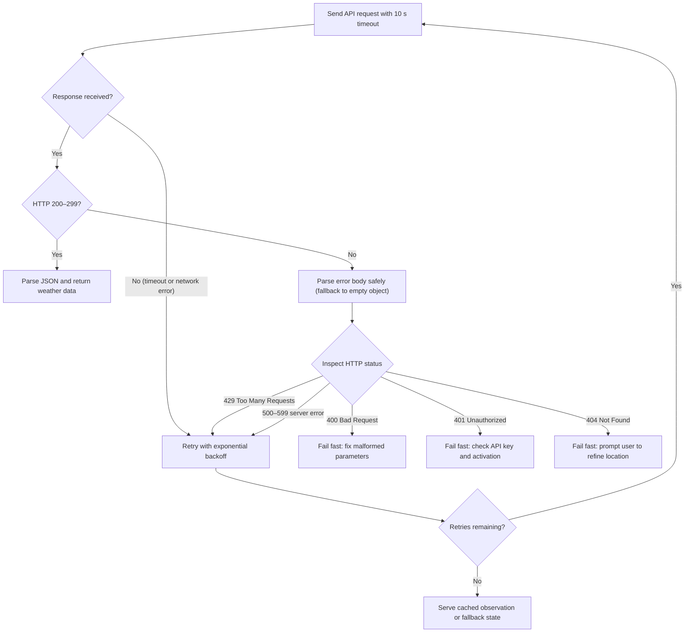

import Tabs from '@theme/Tabs';
import TabItem from '@theme/TabItem';

# Handle errors in production

Production weather integrations must distinguish permanent client errors (such as invalid credentials or unknown locations) from transient rate-limit and upstream gateway failures without crashing on unexpected payloads.

## Check HTTP status codes before parsing JSON

When OpenWeatherMap rejects a request at the application layer, it returns an HTTP error status alongside a JSON object containing `cod` and `message`:

```json
{
  "cod": "404",
  "message": "city not found"
}
```

:::warning Inconsistent status code types in payloads
OpenWeatherMap returns `cod` as a string in some responses (such as `"404"`) and as a number in others (such as `401`). Always branch on the HTTP transport status (`response.status` in Node.js or `response.status_code` in Python) instead of comparing `data.cod` with strict type equality.
:::

Guard your JSON parser on non-2xx responses as well. Upstream load balancers and reverse proxies can return an HTML error document during `502 Bad Gateway` or `503 Service Unavailable` incidents. Calling an unguarded `response.json()` on an HTML body throws a syntax exception and masks the underlying HTTP status code.



## Retry transient failures with exponential backoff

Only retry errors that can succeed on a subsequent attempt:

- **Fail fast (zero retries)** on `400 Bad Request`, `401 Unauthorized`, and `404 Not Found`. Retrying permanent client errors wastes quota and delays feedback to the user.
- **Retry with exponential backoff and jitter** on `429 Too Many Requests`, `500–599` server errors, and network timeouts. Because OpenWeatherMap omits the `Retry-After` header on `429` responses, rely on computed exponential backoff—while still honoring `Retry-After` if an intermediate proxy or gateway supplies it.

<Tabs groupId="language">
<TabItem value="nodejs" label="Node.js" default>

```javascript
const apiKey = process.env.OPENWEATHER_API_KEY;

class WeatherApiError extends Error {
  constructor(message, { status, retryable }) {
    super(message);
    this.name = 'WeatherApiError';
    this.status = status;
    this.retryable = retryable;
  }
}

const delay = (ms) => new Promise((resolve) => setTimeout(resolve, ms));

function computeBackoffMs(attempt, retryAfterHeader) {
  const retryAfterSeconds = Number(retryAfterHeader);
  if (Number.isFinite(retryAfterSeconds) && retryAfterSeconds > 0) {
    return retryAfterSeconds * 1000;
  }
  const baseMs = 1000 * 2 ** attempt;
  const jitterMs = Math.floor(Math.random() * 300);
  return baseMs + jitterMs;
}

export async function fetchWeatherWithRetry(lat, lon, { maxRetries = 3 } = {}) {
  const params = new URLSearchParams({
    lat: String(lat),
    lon: String(lon),
    units: 'metric',
    appid: apiKey,
  });
  const url = `https://api.openweathermap.org/data/2.5/weather?${params}`;

  for (let attempt = 0; attempt <= maxRetries; attempt += 1) {
    let response;

    try {
      response = await fetch(url, { signal: AbortSignal.timeout(10000) });
    } catch (networkError) {
      if (attempt === maxRetries) {
        throw new WeatherApiError(
          `Network or timeout failure after ${maxRetries + 1} attempts: ${networkError.message}`,
          { status: null, retryable: true }
        );
      }
      await delay(computeBackoffMs(attempt, null));
      continue;
    }

    if (response.ok) {
      return response.json();
    }

    // Parse body defensively in case a 502 or 503 proxy returns HTML instead of JSON
    const payload = await response.json().catch(() => ({}));
    const detail =
      typeof payload?.message === 'string' ? payload.message : response.statusText;

    if (response.status === 400) {
      throw new WeatherApiError(`Invalid request parameters: ${detail}`, {
        status: 400,
        retryable: false,
      });
    }

    if (response.status === 401) {
      throw new WeatherApiError(
        `Authentication rejected (${detail}). Verify OPENWEATHER_API_KEY and key activation.`,
        { status: 401, retryable: false }
      );
    }

    if (response.status === 404) {
      throw new WeatherApiError(`Requested location not found: ${detail}`, {
        status: 404,
        retryable: false,
      });
    }

    const isRetryable =
      response.status === 429 || (response.status >= 500 && response.status <= 599);

    if (!isRetryable || attempt === maxRetries) {
      throw new WeatherApiError(
        `OpenWeatherMap HTTP ${response.status} (${detail})`,
        { status: response.status, retryable: isRetryable }
      );
    }

    const waitMs = computeBackoffMs(attempt, response.headers.get('retry-after'));
    console.warn(
      `Transient HTTP ${response.status} on attempt ${attempt + 1}; retrying in ${waitMs} ms`
    );
    await delay(waitMs);
  }
}
```

</TabItem>
<TabItem value="python" label="Python">

```python
import os
import random
import time
import requests

API_KEY = os.environ["OPENWEATHER_API_KEY"]
WEATHER_URL = "https://api.openweathermap.org/data/2.5/weather"


class WeatherApiError(Exception):
    def __init__(self, message: str, *, status: int | None, retryable: bool) -> None:
        super().__init__(message)
        self.status = status
        self.retryable = retryable


def compute_backoff_seconds(attempt: int, retry_after_header: str | None) -> float:
    if retry_after_header is not None:
        try:
            parsed = float(retry_after_header)
            if parsed > 0:
                return parsed
        except ValueError:
            pass
    base_seconds = 1.0 * (2**attempt)
    jitter_seconds = random.uniform(0.0, 0.3)
    return base_seconds + jitter_seconds


def fetch_weather_with_retry(
    lat: float, lon: float, *, max_retries: int = 3
) -> dict:
    params = {
        "lat": lat,
        "lon": lon,
        "units": "metric",
        "appid": API_KEY,
    }

    for attempt in range(max_retries + 1):
        try:
            response = requests.get(WEATHER_URL, params=params, timeout=10)
        except requests.RequestException as exc:
            if attempt == max_retries:
                raise WeatherApiError(
                    f"Network or timeout failure after {max_retries + 1} attempts: {exc}",
                    status=None,
                    retryable=True,
                ) from exc
            time.sleep(compute_backoff_seconds(attempt, None))
            continue

        if 200 <= response.status_code <= 299:
            return response.json()

        # Parse body defensively in case a 502 or 503 proxy returns HTML instead of JSON
        try:
            payload = response.json()
        except ValueError:
            payload = {}

        detail = (
            payload.get("message")
            if isinstance(payload, dict) and isinstance(payload.get("message"), str)
            else response.reason
        )

        if response.status_code == 400:
            raise WeatherApiError(
                f"Invalid request parameters: {detail}",
                status=400,
                retryable=False,
            )

        if response.status_code == 401:
            raise WeatherApiError(
                f"Authentication rejected ({detail}). Verify OPENWEATHER_API_KEY and key activation.",
                status=401,
                retryable=False,
            )

        if response.status_code == 404:
            raise WeatherApiError(
                f"Requested location not found: {detail}",
                status=404,
                retryable=False,
            )

        is_retryable = response.status_code == 429 or (
            500 <= response.status_code <= 599
        )

        if not is_retryable or attempt == max_retries:
            raise WeatherApiError(
                f"OpenWeatherMap HTTP {response.status_code} ({detail})",
                status=response.status_code,
                retryable=is_retryable,
            )

        wait_seconds = compute_backoff_seconds(
            attempt, response.headers.get("Retry-After")
        )
        print(
            f"Transient HTTP {response.status_code} on attempt {attempt + 1}; "
            f"retrying in {wait_seconds:.2f} s"
        )
        time.sleep(wait_seconds)

    raise AssertionError("Unreachable retry loop exit")
```

</TabItem>
</Tabs>

## Serve cached data during outages

When upstream retries are exhausted, keep your interface usable instead of rendering a blank page:

1. **Serve stale-on-error cache entries**: Retain the most recent observation for each location alongside its `dt` observation timestamp. If live retries fail, return the cached payload marked as stale and display an explicit timestamp banner such as *"Showing conditions observed at 14:20 UTC."*
2. **Differentiate user-recoverable errors from outages**: Surface `404 Not Found` as an inline prompt inviting the user to pick another city, while logging `401 Unauthorized` and `500–599` failures to your server telemetry without exposing internal stack traces.

## Related resources

- [Error codes reference](../reference/error-codes) for every HTTP status code and OpenWeatherMap error payload schema
- [Common errors](../troubleshooting/common-errors) for step-by-step diagnostics when troubleshooting `401`, `404`, and `429` responses
- [Set up rate limiting and caching](./rate-limiting) to prevent `429 Too Many Requests` errors with a bounded backend cache
