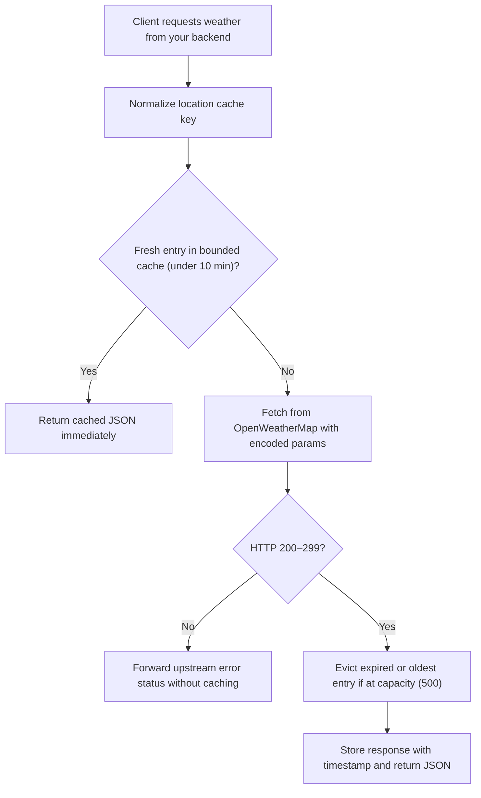

import Tabs from '@theme/Tabs';
import TabItem from '@theme/TabItem';

# Set up rate limiting and caching

OpenWeatherMap's free tier enforces two quotas across all applications sharing an API key: a burst limit of **60 requests per minute** and a monthly cap of **1,000,000 calls per month**. Exceeding the burst limit returns `429 Too Many Requests`. For tier-by-tier quota details, see [Rate limits](../reference/rate-limits).

## Align cache TTL with weather update intervals

Never call `api.openweathermap.org` directly from client browsers or mobile apps. In addition to exposing `OPENWEATHER_API_KEY`, client-side calls multiply traffic linearly with concurrent visitors: 120 visitors opening your homepage in the same minute trigger 120 upstream calls and trip `429 Too Many Requests`.

Route all client weather requests through a backend proxy configured with a **10-minute (`600 s`) cache time-to-live (TTL)**:

- **Matches upstream model cadence**: OpenWeatherMap refreshes station and model observations roughly every 10 minutes, so polling more frequently for the same location returns identical readings. See [How weather data works](../concepts/how-weather-data-works) for details on observation refresh cycles.
- **Protects both quotas**: Whether 10 or 10,000 users view London within a 10-minute window, your proxy sends **1 upstream call** and serves the remaining requests from memory.



## Build a bounded caching proxy

A production caching proxy must enforce four safeguards:

1. **Validate `OPENWEATHER_API_KEY` at startup** so misconfigured deployments fail immediately rather than returning `401` on live traffic.
2. **Normalize cache keys** (`city.trim().toLowerCase()`) so `"London"`, `"london"`, and `" london "` share a single cache slot.
3. **Serialize query parameters safely** (`URLSearchParams` in Node.js or `params={...}` in Python) so user-supplied `:city` path segments containing `&`, `?`, or `#` cannot inject extra query parameters into the upstream URL.
4. **Cap maximum cache size** (`MAX_CACHE_ENTRIES = 500`) and evict expired or least-recently-used entries so random or adversarial city queries cannot exhaust server heap memory.

<Tabs groupId="language">
<TabItem value="nodejs" label="Node.js" default>

Install Express in an ES module project (Node.js 20+ provides native `fetch` and `URLSearchParams`):

```bash
npm install express
```

Save the following proxy as `server.mjs` and start it with `node server.mjs`:

```javascript
import express from 'express';

const API_KEY = process.env.OPENWEATHER_API_KEY?.trim();
if (!API_KEY) {
  throw new Error('Missing required environment variable: OPENWEATHER_API_KEY');
}

const WEATHER_URL = 'https://api.openweathermap.org/data/2.5/weather';
const CACHE_TTL_MS = 10 * 60 * 1000;
const MAX_CACHE_ENTRIES = 500;
const PORT = Number(process.env.PORT) || 3000;

const app = express();
const cache = new Map();

function getCachedEntry(key) {
  const entry = cache.get(key);
  if (!entry) {
    return null;
  }
  if (Date.now() - entry.timestamp >= CACHE_TTL_MS) {
    cache.delete(key);
    return null;
  }
  // Refresh Map insertion order so active locations remain cached
  cache.delete(key);
  cache.set(key, entry);
  return entry.data;
}

function setCachedEntry(key, data) {
  const now = Date.now();
  if (cache.has(key)) {
    cache.delete(key);
  } else if (cache.size >= MAX_CACHE_ENTRIES) {
    for (const [existingKey, entry] of cache) {
      if (now - entry.timestamp >= CACHE_TTL_MS) {
        cache.delete(existingKey);
      }
    }
    if (cache.size >= MAX_CACHE_ENTRIES) {
      const oldestKey = cache.keys().next().value;
      cache.delete(oldestKey);
    }
  }
  cache.set(key, { timestamp: now, data });
}

async function fetchCachedWeather(cacheKey, searchParams, res) {
  const cached = getCachedEntry(cacheKey);
  if (cached) {
    res.set('X-Cache', 'HIT');
    return res.json(cached);
  }

  try {
    const upstream = await fetch(`${WEATHER_URL}?${searchParams}`, {
      signal: AbortSignal.timeout(10000),
    });

    const payload = await upstream.json().catch(() => ({}));
    if (!upstream.ok) {
      return res.status(upstream.status).json({
        error: payload?.message ?? 'Upstream weather request failed',
      });
    }

    setCachedEntry(cacheKey, payload);
    res.set('X-Cache', 'MISS');
    return res.json(payload);
  } catch (error) {
    console.error(`Upstream fetch failed for ${cacheKey}: ${error.message}`);
    return res.status(502).json({ error: 'Upstream weather service unavailable' });
  }
}

// Coordinate lookup route: GET /api/weather?lat=35.6895&lon=139.6917
app.get('/api/weather', async (req, res) => {
  const lat = Number(req.query.lat);
  const lon = Number(req.query.lon);

  if (!Number.isFinite(lat) || lat < -90 || lat > 90 || !Number.isFinite(lon) || lon < -180 || lon > 180) {
    return res.status(400).json({ error: 'Provide valid numeric lat (-90 to 90) and lon (-180 to 180) parameters.' });
  }

  const latFixed = lat.toFixed(3);
  const lonFixed = lon.toFixed(3);
  const params = new URLSearchParams({
    lat: latFixed,
    lon: lonFixed,
    units: 'metric',
    appid: API_KEY,
  });

  return fetchCachedWeather(`coord:${latFixed},${lonFixed}`, params, res);
});

// City lookup route: GET /api/weather/:city
app.get('/api/weather/:city', async (req, res) => {
  const normalizedCity = req.params.city.trim().toLowerCase();
  if (!normalizedCity || normalizedCity.length > 120) {
    return res.status(400).json({ error: 'Provide a non-empty city query up to 120 characters.' });
  }

  const params = new URLSearchParams({
    q: normalizedCity,
    units: 'metric',
    appid: API_KEY,
  });

  return fetchCachedWeather(`city:${normalizedCity}`, params, res);
});

app.listen(PORT, () => {
  console.log(`Weather caching proxy listening on port ${PORT}`);
});
```

</TabItem>
<TabItem value="python" label="Python">

Install FastAPI, Uvicorn, and HTTPX:

```bash
pip install fastapi uvicorn httpx
```

Save the following proxy as `server.py` and start it with `uvicorn server:app --port 3000`:

```python
from collections import OrderedDict
from contextlib import asynccontextmanager
import os
import time
from fastapi import FastAPI, HTTPException, Query, Response
import httpx

API_KEY = os.environ.get("OPENWEATHER_API_KEY", "").strip()
if not API_KEY:
    raise RuntimeError("Missing required environment variable: OPENWEATHER_API_KEY")

WEATHER_URL = "https://api.openweathermap.org/data/2.5/weather"
CACHE_TTL_SECONDS = 600.0
MAX_CACHE_ENTRIES = 500

cache: OrderedDict[str, tuple[float, dict]] = OrderedDict()


@asynccontextmanager
async def lifespan(app: FastAPI):
    async with httpx.AsyncClient(timeout=10.0) as client:
        app.state.http_client = client
        yield


app = FastAPI(lifespan=lifespan)


def get_cached_entry(key: str) -> dict | None:
    entry = cache.get(key)
    if entry is None:
        return None
    timestamp, data = entry
    if time.monotonic() - timestamp >= CACHE_TTL_SECONDS:
        del cache[key]
        return None
    cache.move_to_end(key)
    return data


def set_cached_entry(key: str, data: dict) -> None:
    now = time.monotonic()
    if key in cache:
        del cache[key]
    elif len(cache) >= MAX_CACHE_ENTRIES:
        expired_keys = [
            k for k, (ts, _) in cache.items() if now - ts >= CACHE_TTL_SECONDS
        ]
        for k in expired_keys:
            del cache[k]
        if len(cache) >= MAX_CACHE_ENTRIES:
            cache.popitem(last=False)
    cache[key] = (now, data)


async def fetch_cached_weather(
    cache_key: str, query_params: dict[str, str], response: Response
) -> dict:
    cached = get_cached_entry(cache_key)
    if cached is not None:
        response.headers["X-Cache"] = "HIT"
        return cached

    client: httpx.AsyncClient = app.state.http_client
    try:
        upstream = await client.get(WEATHER_URL, params=query_params)
    except httpx.HTTPError as exc:
        raise HTTPException(
            status_code=502, detail="Upstream weather service unavailable"
        ) from exc

    try:
        payload = upstream.json()
    except ValueError:
        payload = {}

    if upstream.status_code < 200 or upstream.status_code > 299:
        detail = (
            payload.get("message")
            if isinstance(payload, dict) and isinstance(payload.get("message"), str)
            else "Upstream weather request failed"
        )
        raise HTTPException(status_code=upstream.status_code, detail=detail)

    set_cached_entry(cache_key, payload)
    response.headers["X-Cache"] = "MISS"
    return payload


@app.get("/api/weather")
async def get_weather_by_coordinates(
    response: Response,
    lat: float = Query(..., ge=-90.0, le=90.0),
    lon: float = Query(..., ge=-180.0, le=180.0),
) -> dict:
    lat_fixed = f"{lat:.3f}"
    lon_fixed = f"{lon:.3f}"
    params = {
        "lat": lat_fixed,
        "lon": lon_fixed,
        "units": "metric",
        "appid": API_KEY,
    }
    return await fetch_cached_weather(f"coord:{lat_fixed},{lon_fixed}", params, response)


@app.get("/api/weather/{city}")
async def get_weather_by_city(city: str, response: Response) -> dict:
    normalized_city = city.strip().lower()
    if not normalized_city or len(normalized_city) > 120:
        raise HTTPException(
            status_code=400,
            detail="Provide a non-empty city query up to 120 characters.",
        )
    params = {
        "q": normalized_city,
        "units": "metric",
        "appid": API_KEY,
    }
    return await fetch_cached_weather(f"city:{normalized_city}", params, response)
```

</TabItem>
</Tabs>

:::tip Share cache state across horizontally scaled workers
An in-process `Map` or `OrderedDict` isolates cache entries per process. If you run multiple container replicas or cluster workers behind a load balancer, store cached JSON payloads in Redis with `SET key payload EX 600` so all replicas share a single 10-minute cache.
:::

## Throttle batch and scheduled scripts

When a scheduled worker refreshes weather data for dozens or hundreds of saved locations, firing requests concurrently with `Promise.all` or a tight loop breaches the 60 requests per minute limit within seconds.

Space sequential calls by **`1,100 ms`** (~54 requests per minute), and combine pacing with automatic `429 Too Many Requests` backoff in case another service sharing your API key consumes part of the per-minute budget:

<Tabs groupId="language">
<TabItem value="nodejs" label="Node.js" default>

```javascript
const API_KEY = process.env.OPENWEATHER_API_KEY?.trim();
if (!API_KEY) {
  throw new Error('Missing required environment variable: OPENWEATHER_API_KEY');
}

const PACE_INTERVAL_MS = 1100;
const MAX_RATE_LIMIT_RETRIES = 3;

const delay = (ms) => new Promise((resolve) => setTimeout(resolve, ms));

async function fetchLocationPaced(lat, lon) {
  const params = new URLSearchParams({
    lat: String(lat),
    lon: String(lon),
    units: 'metric',
    appid: API_KEY,
  });

  for (let attempt = 0; attempt <= MAX_RATE_LIMIT_RETRIES; attempt += 1) {
    const response = await fetch(
      `https://api.openweathermap.org/data/2.5/weather?${params}`,
      { signal: AbortSignal.timeout(10000) }
    );

    if (response.ok) {
      return response.json();
    }

    if (response.status === 429 && attempt < MAX_RATE_LIMIT_RETRIES) {
      const retryHeader = Number(response.headers.get('retry-after'));
      const backoffMs =
        Number.isFinite(retryHeader) && retryHeader > 0
          ? retryHeader * 1000
          : 2000 * 2 ** attempt;
      console.warn(`Hit HTTP 429; pausing batch for ${backoffMs} ms`);
      await delay(backoffMs);
      continue;
    }

    throw new Error(`Request for (${lat}, ${lon}) failed with HTTP ${response.status}`);
  }
}

async function syncLocationsBatch(locations) {
  const results = [];

  for (let i = 0; i < locations.length; i += 1) {
    const { label, lat, lon } = locations[i];
    const data = await fetchLocationPaced(lat, lon);
    results.push({ label, tempCelsius: data.main.temp });
    console.log(`[${i + 1}/${locations.length}] ${label}: ${data.main.temp} °C`);

    if (i < locations.length - 1) {
      await delay(PACE_INTERVAL_MS);
    }
  }

  return results;
}

await syncLocationsBatch([
  { label: 'Tokyo', lat: 35.6895, lon: 139.6917 },
  { label: 'London', lat: 51.5074, lon: -0.1278 },
  { label: 'São Paulo', lat: -23.5505, lon: -46.6333 },
]);
```

</TabItem>
<TabItem value="python" label="Python">

```python
import os
import time
import requests

API_KEY = os.environ.get("OPENWEATHER_API_KEY", "").strip()
if not API_KEY:
    raise RuntimeError("Missing required environment variable: OPENWEATHER_API_KEY")

WEATHER_URL = "https://api.openweathermap.org/data/2.5/weather"
PACE_INTERVAL_SECONDS = 1.1
MAX_RATE_LIMIT_RETRIES = 3


def fetch_location_paced(lat: float, lon: float) -> dict:
    params = {
        "lat": lat,
        "lon": lon,
        "units": "metric",
        "appid": API_KEY,
    }

    for attempt in range(MAX_RATE_LIMIT_RETRIES + 1):
        response = requests.get(WEATHER_URL, params=params, timeout=10)

        if 200 <= response.status_code <= 299:
            return response.json()

        if response.status_code == 429 and attempt < MAX_RATE_LIMIT_RETRIES:
            retry_header = response.headers.get("Retry-After")
            backoff_seconds = 2.0 * (2**attempt)
            if retry_header is not None:
                try:
                    parsed = float(retry_header)
                    if parsed > 0:
                        backoff_seconds = parsed
                except ValueError:
                    pass
            print(f"Hit HTTP 429; pausing batch for {backoff_seconds:.1f} s")
            time.sleep(backoff_seconds)
            continue

        raise RuntimeError(
            f"Request for ({lat}, {lon}) failed with HTTP {response.status_code}"
        )

    raise AssertionError("Unreachable retry loop exit")


def sync_locations_batch(locations: list[dict]) -> list[dict]:
    results = []

    for index, loc in enumerate(locations):
        data = fetch_location_paced(loc["lat"], loc["lon"])
        results.append({"label": loc["label"], "temp_celsius": data["main"]["temp"]})
        print(f"[{index + 1}/{len(locations)}] {loc['label']}: {data['main']['temp']} °C")

        if index < len(locations) - 1:
            time.sleep(PACE_INTERVAL_SECONDS)

    return results


sync_locations_batch(
    [
        {"label": "Tokyo", "lat": 35.6895, "lon": 139.6917},
        {"label": "London", "lat": 51.5074, "lon": -0.1278},
        {"label": "São Paulo", "lat": -23.5505, "lon": -46.6333},
    ]
)
```

</TabItem>
</Tabs>

## Related resources

- [Rate limits](../reference/rate-limits) for quota thresholds across free and paid OpenWeatherMap plans
- [How weather data works](../concepts/how-weather-data-works) for model update cycles and station observation timing
- [Architecture overview](../concepts/architecture) for client-to-proxy-to-OpenWeatherMap request topology
- [Handle errors in production](./handle-errors) for full retry and fallback handling across `4xx` and `5xx` responses
