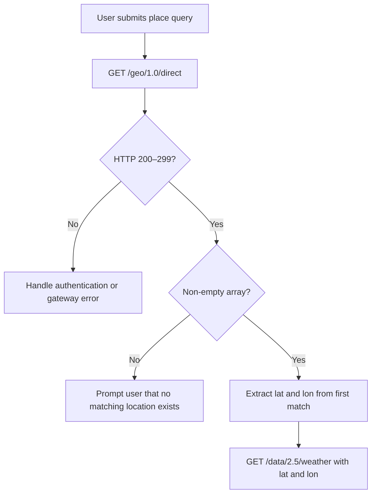

import Tabs from '@theme/Tabs';
import TabItem from '@theme/TabItem';

# Use geographic coordinates

Querying OpenWeatherMap endpoints with `lat` and `lon` eliminates duplicate-city ambiguity and uses OpenWeatherMap's primary coordinate lookup path instead of legacy name matching.

## Resolve a city name to coordinates

When a user searches for a city, resolve the text query to coordinates with Geocoding API 1.0 (`/geo/1.0/direct`) first, validate the response, and pass `lat` and `lon` to `/data/2.5/weather`:



Always check **both** the HTTP status code and whether the parsed JSON body is a non-empty array before reading `geoData[0]`:

- An invalid API key returns HTTP `401` with a JSON object (`{"cod": 401, ...}`), where `geoData.length` is `undefined`.
- An unrecognized place name returns HTTP `200` with an empty JSON array (`[]`).

<Tabs groupId="language">
<TabItem value="curl" label="curl" default>

```bash
# Step 1: Resolve "Paris,FR" to latitude and longitude
curl --get "https://api.openweathermap.org/geo/1.0/direct" \
  --data-urlencode "q=Paris,FR" \
  --data-urlencode "limit=1" \
  --data-urlencode "appid=$OPENWEATHER_API_KEY"

# Step 2: Query current weather with the returned coordinates
curl --get "https://api.openweathermap.org/data/2.5/weather" \
  --data-urlencode "lat=48.8588897" \
  --data-urlencode "lon=2.3200410217200766" \
  --data-urlencode "units=metric" \
  --data-urlencode "appid=$OPENWEATHER_API_KEY"
```

</TabItem>
<TabItem value="nodejs" label="Node.js">

```javascript
const apiKey = process.env.OPENWEATHER_API_KEY;

async function getWeatherForPlace(placeQuery) {
  const geoParams = new URLSearchParams({
    q: placeQuery,
    limit: '1',
    appid: apiKey,
  });

  const geoResponse = await fetch(
    `https://api.openweathermap.org/geo/1.0/direct?${geoParams}`,
    { signal: AbortSignal.timeout(10000) }
  );

  if (!geoResponse.ok) {
    throw new Error(`Geocoding request failed with HTTP ${geoResponse.status}`);
  }

  const geoData = await geoResponse.json();
  if (!Array.isArray(geoData) || geoData.length === 0) {
    throw new Error(`No coordinates found for "${placeQuery}"`);
  }

  const { name, state, country, lat, lon } = geoData[0];

  const weatherParams = new URLSearchParams({
    lat: String(lat),
    lon: String(lon),
    units: 'metric',
    appid: apiKey,
  });

  const weatherResponse = await fetch(
    `https://api.openweathermap.org/data/2.5/weather?${weatherParams}`,
    { signal: AbortSignal.timeout(10000) }
  );

  if (!weatherResponse.ok) {
    throw new Error(`Weather request failed with HTTP ${weatherResponse.status}`);
  }

  const weather = await weatherResponse.json();
  return {
    resolvedName: [name, state, country].filter(Boolean).join(', '),
    lat,
    lon,
    tempCelsius: weather.main.temp,
    description: weather.weather[0].description,
  };
}

const result = await getWeatherForPlace('Paris,FR');
console.log(result);
```

</TabItem>
<TabItem value="python" label="Python">

```python
import os
import requests

API_KEY = os.environ["OPENWEATHER_API_KEY"]
DIRECT_GEO_URL = "https://api.openweathermap.org/geo/1.0/direct"
WEATHER_URL = "https://api.openweathermap.org/data/2.5/weather"


def get_weather_for_place(place_query: str) -> dict:
    geo_response = requests.get(
        DIRECT_GEO_URL,
        params={"q": place_query, "limit": 1, "appid": API_KEY},
        timeout=10,
    )
    geo_response.raise_for_status()

    geo_data = geo_response.json()
    if not isinstance(geo_data, list) or len(geo_data) == 0:
        raise ValueError(f'No coordinates found for "{place_query}"')

    match = geo_data[0]
    lat = match["lat"]
    lon = match["lon"]

    weather_response = requests.get(
        WEATHER_URL,
        params={"lat": lat, "lon": lon, "units": "metric", "appid": API_KEY},
        timeout=10,
    )
    weather_response.raise_for_status()
    weather = weather_response.json()

    label_parts = [match.get("name"), match.get("state"), match.get("country")]
    return {
        "resolved_name": ", ".join(part for part in label_parts if part),
        "lat": lat,
        "lon": lon,
        "temp_celsius": weather["main"]["temp"],
        "description": weather["weather"][0]["description"],
    }


print(get_weather_for_place("Paris,FR"))
```

</TabItem>
</Tabs>

:::tip Cache resolved coordinates aggressively
City coordinates don't change. Cache `/geo/1.0/direct` lookups by normalized query string for days or weeks so repeat searches consume only a single weather API call.
:::

## Convert coordinates to a place name

When your application starts from raw GPS or map-pin coordinates and needs a human-readable locality label, query the reverse geocoding endpoint (`/geo/1.0/reverse`) with `lat`, `lon`, and `limit=1`:

<Tabs groupId="language">
<TabItem value="curl" label="curl" default>

```bash
curl --get "https://api.openweathermap.org/geo/1.0/reverse" \
  --data-urlencode "lat=35.6895" \
  --data-urlencode "lon=139.6917" \
  --data-urlencode "limit=1" \
  --data-urlencode "appid=$OPENWEATHER_API_KEY"
```

</TabItem>
<TabItem value="nodejs" label="Node.js">

```javascript
const params = new URLSearchParams({
  lat: '35.6895',
  lon: '139.6917',
  limit: '1',
  appid: process.env.OPENWEATHER_API_KEY,
});

const response = await fetch(
  `https://api.openweathermap.org/geo/1.0/reverse?${params}`,
  { signal: AbortSignal.timeout(10000) }
);

if (!response.ok) {
  throw new Error(`Reverse geocoding failed with HTTP ${response.status}`);
}

const places = await response.json();
if (Array.isArray(places) && places.length > 0) {
  const { name, state, country } = places[0];
  console.log([name, state, country].filter(Boolean).join(', '));
}
```

</TabItem>
<TabItem value="python" label="Python">

```python
import os
import requests

response = requests.get(
    "https://api.openweathermap.org/geo/1.0/reverse",
    params={
        "lat": 35.6895,
        "lon": 139.6917,
        "limit": 1,
        "appid": os.environ["OPENWEATHER_API_KEY"],
    },
    timeout=10,
)
response.raise_for_status()

places = response.json()
if isinstance(places, list) and len(places) > 0:
    place = places[0]
    parts = [place.get("name"), place.get("state"), place.get("country")]
    print(", ".join(part for part in parts if part))
```

</TabItem>
</Tabs>

## Pass browser coordinates through your backend

In web applications, you can read the user's coordinates from the browser Geolocation API (`navigator.geolocation.getCurrentPosition`) without asking them to type a city name.

:::danger Keep your API key on the server
Never call `api.openweathermap.org` directly from client-side browser code. Any key bundled into frontend JavaScript or sent from browser network requests is visible to every visitor. Send `lat` and `lon` to your own backend endpoint, and attach `OPENWEATHER_API_KEY` on the server.
:::

Capture coordinates in the browser and forward them to your own backend route (`/api/weather`):

```javascript
function loadLocalWeather(onSuccess, onFallbackRequired) {
  if (!('geolocation' in navigator)) {
    onFallbackRequired('Browser geolocation is unavailable.');
    return;
  }

  navigator.geolocation.getCurrentPosition(
    async (position) => {
      try {
        const params = new URLSearchParams({
          lat: position.coords.latitude.toFixed(4),
          lon: position.coords.longitude.toFixed(4),
        });

        // Send coordinates to your own backend proxy rather than OpenWeatherMap directly
        const response = await fetch(`/api/weather?${params}`, {
          signal: AbortSignal.timeout(10000),
        });

        if (!response.ok) {
          throw new Error(`Backend weather route returned HTTP ${response.status}`);
        }

        const weather = await response.json();
        onSuccess(weather);
      } catch (error) {
        onFallbackRequired(error.message);
      }
    },
    (geoError) => {
      onFallbackRequired(`Location permission declined or timed out (${geoError.message}).`);
    },
    { enableHighAccuracy: false, timeout: 8000, maximumAge: 600000 }
  );
}
```

Rounding `latitude` and `longitude` to 2–4 decimal places before calling `/api/weather` improves privacy and increases cache hit rates across nearby users. To build the `/api/weather` server route with bounded caching, see [Set up rate limiting and caching](./rate-limiting).

:::tip Provide a manual search fallback
Users frequently decline browser location prompts. Pair geolocation with a city-search input backed by `/geo/1.0/direct` on your server so users can always select a location manually.
:::

## Related resources

- [Geocoding reference](../reference/geocoding) for direct, postal-code, and reverse geocoding schemas
- [Current weather reference](../reference/current-weather) for coordinate query parameters and response fields
- [Set up rate limiting and caching](./rate-limiting) to build the server-side `/api/weather` proxy safely
- [Handle errors in production](./handle-errors) to handle timeouts and upstream HTTP errors
