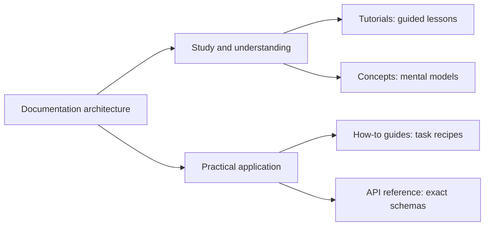

# OpenWeatherMap API documentation

Welcome to the unofficial developer documentation for the OpenWeatherMap REST API, authored as a technical writing portfolio sample by [Michel Silveira](https://michelgss.github.io/portfolio/).

This site guides you from your first authenticated `200 OK` request to production-ready caching, coordinate resolution, and error recovery. Every page follows the [Diátaxis framework](https://diataxis.fr/) so you can move directly to hands-on learning, task-oriented code recipes, exact endpoint schemas, or architectural mental models.

## What you can access on the free tier

OpenWeatherMap's free tier requires **no credit card** and includes **60 calls per minute** and **1,000,000 calls per month** across two versioned REST services under `https://api.openweathermap.org`:

- **Current weather (`GET /data/2.5/weather`)**: Near-real-time temperature, humidity, atmospheric pressure, wind vector, visibility, cloud cover, and precipitation observations refreshed every 10 minutes.
- **5-day forecast (`GET /data/2.5/forecast`)**: 40 forecast steps in 3-hour synoptic UTC intervals covering the next 5 days, including probability of precipitation (`pop`) and 3-hour rain or snow accumulation.
- **Global geocoding (`GET /geo/1.0/direct`, `/geo/1.0/reverse`, and `/geo/1.0/zip`)**: Forward place-name search, reverse coordinate lookup, and postal-code resolution into exact latitude and longitude coordinates.

Historical weather archives, extended 16-day daily forecasts, and One Call API 3.0 (`/data/3.0/onecall`) require separate paid billing plans and are not included in the free tier.

## Quick links

| Goal | Section | Where to start |
| --- | --- | --- |
| Send your first `200 OK` API request in under 5 minutes | Getting started | [Check prerequisites and set up your key](./getting-started/prerequisites) |
| Build a complete end-to-end weather application | Tutorials | [Build a weather dashboard](./tutorials/weather-dashboard) |
| Copy production-ready recipes in `curl`, Node.js, and Python | How-to guides | [Get current weather](./how-to/get-current-weather) |
| Look up exact parameters, JSON schemas, and status codes | API reference | [Authentication and endpoints](./reference/authentication) |
| Understand meteorological grids, SI units, and proxy topology | Concepts | [How weather data works](./concepts/how-weather-data-works) |
| Diagnose `401`, `404`, `429`, and browser CORS failures | Troubleshooting | [Resolve common errors](./troubleshooting/common-errors) |
| Test live requests in your browser without writing code | Interactive playground | [Open the interactive API playground](/playground) |

## How this documentation is organized

Rather than mixing conceptual background into reference tables or burying task recipes inside beginner lessons, this site separates content across the four [Diátaxis](https://diataxis.fr/) quadrants—supported by dedicated onboarding and troubleshooting paths:

| Diátaxis quadrant | Primary intent | Reader context | Representative pages |
| --- | --- | --- | --- |
| **Tutorials** | Learning through hands-on practice | Studying by building a working project end to end | [Build a weather dashboard](./tutorials/weather-dashboard), [Build a CLI weather tool](./tutorials/weather-cli) |
| **How-to guides** | Accomplishing a specific engineering task | Solving a real integration problem in code | [Query weather by coordinates](./how-to/use-coordinates), [Set up rate limiting and caching](./how-to/rate-limiting) |
| **API reference** | Looking up exact technical facts | Verifying parameters, types, units, and payloads | [Current weather](./reference/current-weather), [5-day forecast](./reference/forecast), [Geocoding](./reference/geocoding) |
| **Concepts** | Deepening architectural understanding | Evaluating how the platform models and serves data | [How weather data works](./concepts/how-weather-data-works), [Unit systems and conversions](./concepts/units), [API architecture overview](./concepts/architecture) |

## About this project

This site runs on [Docusaurus](https://docusaurus.io/) and applies docs-as-code workflows using Git, Markdown, Mermaid diagrams, automated link verification, and CI/CD deployment.

:::note Independent portfolio project
This site is an independent technical writing portfolio sample created by [Michel Silveira](https://michelgss.github.io/portfolio/) and is not affiliated with or endorsed by OpenWeatherMap. For official vendor announcements, billing plans, and enterprise API catalogs, visit the [official OpenWeatherMap API documentation](https://openweathermap.org/api).
:::
