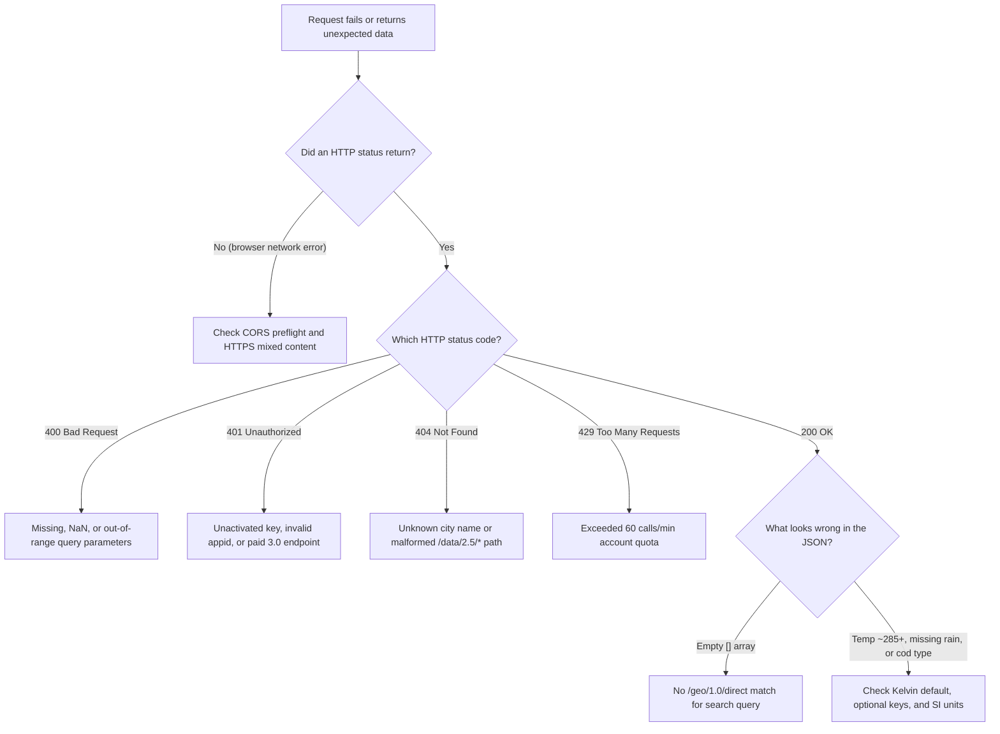

# Common errors

Use the diagnostic flow below to match what your HTTP client or browser console reports to the underlying root cause and recovery pattern.



## 400 Bad Request

### Symptom and error payload

The API rejects the query string before running a lookup and returns HTTP `400` with `"cod": "400"` (formatted as a string):

```json
{
  "cod": "400",
  "message": "Nothing to geocode"
}
```

Invalid geographic coordinates produce a coordinate-specific message:

```json
{
  "cod": "400",
  "message": "wrong latitude"
}
```

### Root causes and solutions

| Root cause | Resolution |
| --- | --- |
| Empty search input (`?q=&appid=...`) submitted before user typing completes | Trim and validate that `q` or `zip` is non-empty before dispatching the request. |
| Uninitialized JavaScript variables serialized as literals (`?lat=undefined&lon=NaN`) | Guard numeric coordinates with `Number.isFinite(lat) && Number.isFinite(lon)` prior to calling `fetch`. |
| Swapped GeoJSON coordinate order (`[lon, lat]` passed as `lat` and `lon`) | Confirm `lat` lies within `-90` to `90` and `lon` lies within `-180` to `180`. |
| Unencoded `#` or `&` characters inside location text truncating the URL | Construct URLs with `URLSearchParams` in JavaScript or `params={...}` in Python rather than string concatenation. |

### Diagnostic check

Log the serialized request URL with `appid` redacted and verify that either `q` or both `lat` and `lon` contain well-formed values:

```bash
curl -i "https://api.openweathermap.org/data/2.5/weather?lat=51.5074&lon=-0.1278&units=metric&appid=$OPENWEATHER_API_KEY"
```

## 401 Unauthorized

### Symptom and error payload

OpenWeatherMap rejects authentication and returns HTTP `401` with an integer `cod` value:

```json
{
  "cod": 401,
  "message": "Invalid API key."
}
```

### Root causes and solutions

| Root cause | Resolution |
| --- | --- |
| Newly created API key is still propagating across edge gateways | Wait **10–15 minutes** (and up to **2 hours** in peak propagation windows) after creating a key before retesting. Do not delete and recreate the key while waiting, which resets the timer. |
| Calling One Call API 3.0 (`/data/3.0/onecall`) or paid endpoints on a free key | Free keys authorize `/data/2.5/weather`, `/data/2.5/forecast`, and `/geo/1.0/*` without billing setup. Calling `/data/3.0/onecall`, `/data/2.5/forecast/daily`, or historical endpoints without an active subscription returns `401 Unauthorized`. |
| Missing, misspelled, or whitespace-padded `appid` parameter | Pass the credential as lowercase `appid=` (not `api_key=` or `key=`) and call `.trim()` on environment variables to strip trailing newline characters from `.env` files. |
| Key was deactivated or deleted in your account | Sign in to the [OpenWeatherMap API keys dashboard](https://home.openweathermap.org/api_keys) and confirm the key status reads **Active**. |

### Diagnostic check

Isolate your API key from application code and `.env` loaders by testing a free-tier 2.5 endpoint directly from your terminal:

```bash
curl -i "https://api.openweathermap.org/data/2.5/weather?q=London,GB&appid=$OPENWEATHER_API_KEY"
```

If this command returns `HTTP/2 200` while your application receives `401`, check whether your code targets `/data/3.0/onecall` or reads an empty environment variable. For credential setup details, see [Authentication](../reference/authentication).

## 404 Not Found and empty geocoding arrays

### Symptom and error payload

Missing locations surface differently depending on which OpenWeatherMap service you call:

- **Weather API 2.5 (`/data/2.5/weather` and `/data/2.5/forecast`)** returns HTTP `404 Not Found` with `"cod": "404"` as a string:

```json
{
  "cod": "404",
  "message": "city not found"
}
```

- **Geocoding API 1.0 (`/geo/1.0/direct`)** returns **HTTP `200 OK` with an empty JSON array** when no location matches—causing unguarded `data[0].lat` reads to throw a runtime `TypeError`:

```json
[]
```

### Root causes and solutions

| Root cause | Resolution |
| --- | --- |
| Omitted service prefix (such as requesting `/weather` instead of `/data/2.5/weather`) | Include the full versioned endpoint path (`/data/2.5/weather`, `/data/2.5/forecast`, or `/geo/1.0/direct`). |
| Ambiguous, localized, or unencoded city name in `?q=` | URL-encode non-ASCII characters and spaces (`São%20Paulo`), or switch to the two-step [Query weather by coordinates](../how-to/use-coordinates) workflow. |
| US state code supplied without ISO 3166 country code (`?q=Austin,TX`) | Append `,US` whenever specifying a US state (`?q=Austin,TX,US`). |
| Non-US postal code passed to `/geo/1.0/zip` without a country code | `/geo/1.0/zip` defaults to the United States when country is omitted; append the two-letter ISO country code (`?zip=SW1A,GB`). |
| Unchecked empty array from `/geo/1.0/direct` | Verify `Array.isArray(results) && results.length > 0` before reading `results[0]`. |

### Diagnostic check

Query the Geocoding API directly with `limit=5` to inspect matching candidates and their canonical coordinates:

```bash
curl -s "https://api.openweathermap.org/geo/1.0/direct?q=Springfield,IL,US&limit=5&appid=$OPENWEATHER_API_KEY"
```

## 429 Too Many Requests

### Symptom and error payload

Exceeding your subscription's burst or monthly quota returns HTTP `429`:

```json
{
  "cod": 429,
  "message": "Your account is temporary blocked due to exceeding of requests limitation of your subscription type."
}
```

### Root causes and solutions

| Root cause | Resolution |
| --- | --- |
| Exceeding 60 calls per minute across all keys on your account | Quotas pool across your entire OpenWeatherMap account rather than per individual key. Add a 10-minute backend cache instead of rotating extra keys. |
| Runaway frontend `useEffect` or reactive state loop | Open your browser DevTools **Network** tab to verify your component isn't re-fetching on every render; debounce search inputs by `300–500 ms`. |
| Unthrottled `Promise.all` or tight loop in scheduled batch jobs | Space sequential batch requests by at least `1,100 ms` (~54 requests/minute) and back off exponentially when `429` occurs. |
| Direct client requests scaling linearly with concurrent website visitors | Move OpenWeatherMap calls behind a shared caching proxy—see [Set up rate limiting and caching](../how-to/rate-limiting). |

### Diagnostic check

When running background sync scripts across multiple saved cities, pace sequential calls so total throughput stays safely below 60 requests per minute:

```javascript
const PACE_INTERVAL_MS = 1100;
const pause = (ms) => new Promise((resolve) => setTimeout(resolve, ms));

for (let i = 0; i < locations.length; i += 1) {
  const weather = await fetchWeatherByCoordinates(locations[i].lat, locations[i].lon);
  results.push(weather);

  if (i < locations.length - 1) {
    await pause(PACE_INTERVAL_MS);
  }
}
```

For full exponential backoff and retry logic on `429` responses, see [Handle errors in production](../how-to/handle-errors).

## Browser CORS preflight and mixed content errors

### Symptom and error payload

No HTTP status code reaches your JavaScript `fetch` handler; instead, the browser console logs a Cross-Origin Resource Sharing (CORS) or mixed-content security error:

```text
Access to fetch at 'https://api.openweathermap.org/data/2.5/weather?...' from origin 'http://localhost:3000' has been blocked by CORS policy: Response to preflight request doesn't pass access control check.
```

Or on an `https://` site calling an `http://` endpoint:

```text
Mixed Content: The page at 'https://example.com' was loaded over HTTPS, but requested an insecure resource 'http://api.openweathermap.org/...'. This request has been blocked.
```

### Root causes and solutions

| Root cause | Resolution |
| --- | --- |
| Custom request headers (`Authorization`, `Content-Type: application/json`, `X-Requested-With`, or `Cache-Control`) attached by frontend HTTP interceptors | Preflight-exempt `GET` requests carry no custom headers. Adding non-CORS-safelisted headers forces the browser to send an `OPTIONS` preflight check, which `api.openweathermap.org` rejects. Remove custom headers—or move the request to your backend. |
| Hardcoded `http://api.openweathermap.org` URL called from an `https://` page | Always use `https://api.openweathermap.org` so browsers never block the request as mixed content. |
| Calling OpenWeatherMap directly from production browser JavaScript | Route frontend requests through your own backend proxy or serverless route (`GET /api/weather`), which eliminates browser CORS restrictions, hides `appid` from DevTools, and shares a 10-minute cache across users. See [API architecture overview](../concepts/architecture). |

### Diagnostic check

Inspect the **Network** tab in browser DevTools and look at the **Method** column:

1. If you see a failed `OPTIONS` request preceding your `GET` request, inspect **Request Headers** to find which global Axios or Fetch interceptor injected `Authorization` or `Content-Type`.
2. Verify the target URL starts with `https://api.openweathermap.org` and passes `appid` in the query string on your backend proxy.

## Unexpected or missing payload fields

When a request succeeds with `200 OK` yet your UI renders implausible numbers or `undefined` properties, check these OpenWeatherMap schema behaviors:

| Observed symptom | Root cause | Resolution |
| --- | --- | --- |
| Temperature reads `280`–`310` | Omitting `units` returns **Kelvin (`K`)** under the default `standard` unit system. | Append `&units=metric` (`°C`) or `&units=imperial` (`°F`), or convert in UI code. See [Unit systems and conversions](../concepts/units). |
| `rain`, `snow`, or `wind.gust` is `undefined` | OpenWeatherMap omits optional precipitation and gust objects whenever accumulation is zero or unmeasured. | Read optional fields defensively (`data.rain?.['1h'] ?? 0` in JavaScript or `data.get("rain", {}).get("1h", 0.0)` in Python). |
| `main.temp_min` equals `main.temp_max` | In `/data/2.5/weather`, those fields reflect current spatial spread across stations in a metro area, not 24-hour daily lows and highs. | Compute daily extremes across intervals in `/data/2.5/forecast`. See [How weather data works](../concepts/how-weather-data-works). |
| `dt` lags behind current time by up to 10 minutes | `dt` records when the meteorological observation snapshot was calculated (refreshed every 10 minutes), not HTTP response time. | Cache responses for 10 minutes instead of re-polling for newer timestamps. |
| `pressure` is `1013` and `rain.1h` is in `mm` despite `units=imperial` | `units` modifies only temperature and wind speed; pressure (`hPa`), precipitation (`mm`), and visibility (`m`) always remain in SI units. | Convert `mm ÷ 25.4` for inches and `hPa × 0.02953` for `inHg`. See [Unit systems and conversions](../concepts/units). |
| Strict `data.cod === 200` check fails | `cod` is serialized as a number (`200`) in `/data/2.5/weather` and as a string (`"200"`) in `/data/2.5/forecast`. | Branch on the HTTP transport status (`response.ok` or `response.status`) instead of `data.cod`. |

## Related resources

- [Error codes reference](../reference/error-codes) for status code definitions and error schemas
- [Handle errors in production](../how-to/handle-errors) for defensive JSON parsing and exponential backoff in Node.js and Python
- [Set up rate limiting and caching](../how-to/rate-limiting) for building a bounded 10-minute caching proxy
- [Frequently asked questions](./faq) for billing plans, API key activation windows, and CC BY-SA 4.0 attribution rules
